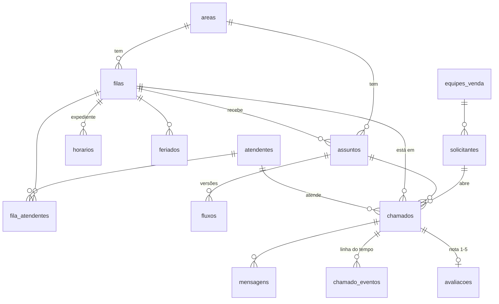

# Modelo de dados · schema `central_atendimento`

Projeto Supabase **Araguaia MC** (`cnbicexublaxoctsxjgq`). Nenhum outro schema é alterado; lemos
`public.employees` (matrícula → nome/e-mail) e copiamos `public.sales_team_mappings` (equipes vigentes).



## Tabelas

| Tabela | Para quê | Campos-chave |
|---|---|---|
| `areas` | Planejamento Integrado, Operações Comerciais, Serviço ao Cliente (e novos setores) | `codigo` (PI, OC, SAC), `ordem`, `ativa` |
| `equipes_venda` | 155 equipes vigentes copiadas do cadastro comercial | `codigo` = `equipe_vendas` |
| `solicitantes` | consultores | `matricula` (única), `email` (ligado no 1º login), `equipe_venda_id`, `funcao` |
| `atendentes` | quem atende | `email`, `papel` (atendente/supervisor/admin), `presenca` (online/pausa/offline), `capacidade` |
| `filas` | destino dos chamados | `area_id`, `distribuicao` (automatica/manual), `sla_espera_min`, `sla_atendimento_min`, `msg_fora_horario` |
| `fila_atendentes` | quem atende cada fila | `prioridade` (1 recebe primeiro) |
| `horarios` / `feriados` | expediente por fila (Brasília) | `dia_semana` 0=domingo |
| `assuntos` | itens do menu do app | `fila_id`, `documento_tipo` (RC/OV/PEDIDO/NF…), `documento_obrigatorio_no_encerramento` |
| `fluxos` | perguntas do chatbot por assunto, versionadas | `versao`, `status` (rascunho/publicado/arquivado; 1 publicado por assunto), `definicao` jsonb |
| `chamados` | o atendimento | `protocolo` (AAMM-00001), `status`, `respostas`, `resumo`, marcos de tempo, `espera_seg`/`atendimento_seg`/`total_seg` (calculados), `resultado`, `documento_tipo/numero`, `desistencia_*`, `qtd_transferencias`, `fora_horario` |
| `mensagens` | conversa | `autor` (solicitante/atendente/bot/sistema), `tipo`, `anexo_path`, `interna`, `lida_em` |
| `chamado_eventos` | linha do tempo | `tipo` (aberto, entrou_fila, atribuido, assumido, repasse, transferencia, devolvido_fila, aguardando_solicitante, retomado, encerrado, desistencia, avaliado, prioridade), de/para fila e atendente, `motivo` |
| `avaliacoes` | nota 1 a 5 + comentário | uma por chamado |
| `respostas_rapidas` | atalhos do atendente (`/ola`) | por área ou geral |
| `config` | parâmetros | `bot_abandono_min`, `resolvido_1o_contato_horas`, `storage_bucket` |
| `auditoria` | quem mudou o quê nos cadastros | escrita só por gatilho |

## Status do chamado

```
bot ──enviar respostas──▶ na_fila ──atribuir/assumir──▶ em_atendimento ⇄ aguardando_solicitante
 │                          │  ▲                              │
 │                          │  └──devolver/transferir─────────┤
 └──────────── desistiu ◀───┴──────────────────────────────────┤
                                                              ▼
                                                         encerrado (resultado obrigatório) ──▶ avaliação 1–5
```

## Indicadores que o modelo já responde

Volume por hora/dia, área, assunto, equipe e atendente; espera e atendimento separados (mediana);
% encerrado em até 30 min; resolução no 1º contato; % transferidos; % com nº de documento;
desistência por etapa (fluxo, fila, atendimento); nota média; fora do expediente.

## Suposições [a validar]

1. **"Schema log-inov"**: não existe um schema com esse nome. Entendi como o projeto Supabase da
   Logística e Inovação (Araguaia MC) e criei um schema próprio, `central_atendimento`, como nas outras aplicações.
2. **Login**: todos os consultores têm conta Microsoft `@araguaia.com.br`. Se houver consultor sem conta, precisamos de outro login.
3. **Matrícula**: `public.employees.employee_id` é a matrícula do consultor. Quem não estiver lá precisa ser pré-cadastrado pelo admin.
4. **Equipe de venda** do consultor: não há ligação matrícula → equipe no banco; fica nula até o admin preencher ou até ligarmos a uma fonte.
5. **Filas**: uma por assunto (9). O BLiP tem 21 filas; os nomes não estão no documento.
6. **Horários**: seg a sex 07:30–18:00, sábado 08:00–12:00.
7. **Perguntas e formatos** dos fluxos (nº da OV/RC com 6–12 dígitos, centro com 4 caracteres, placa Mercosul, CPF do motorista) são uma primeira versão para cada área revisar.
8. **Resolvido no 1º contato**: encerrado como "resolvido" e sem novo chamado do mesmo consultor e assunto em 72 h.
9. **Desistência no fluxo**: 30 min sem enviar.
10. **SLA** por fila (10–20 min de espera) é placeholder; as metas são dos gestores de cada área.
11. **Anexos**: Storage, bucket `central-atendimento` (ainda não criado).
